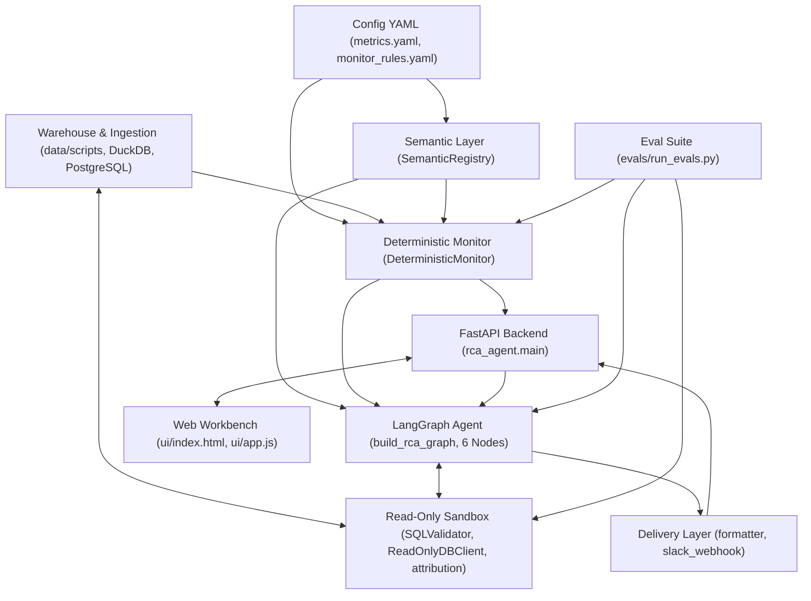
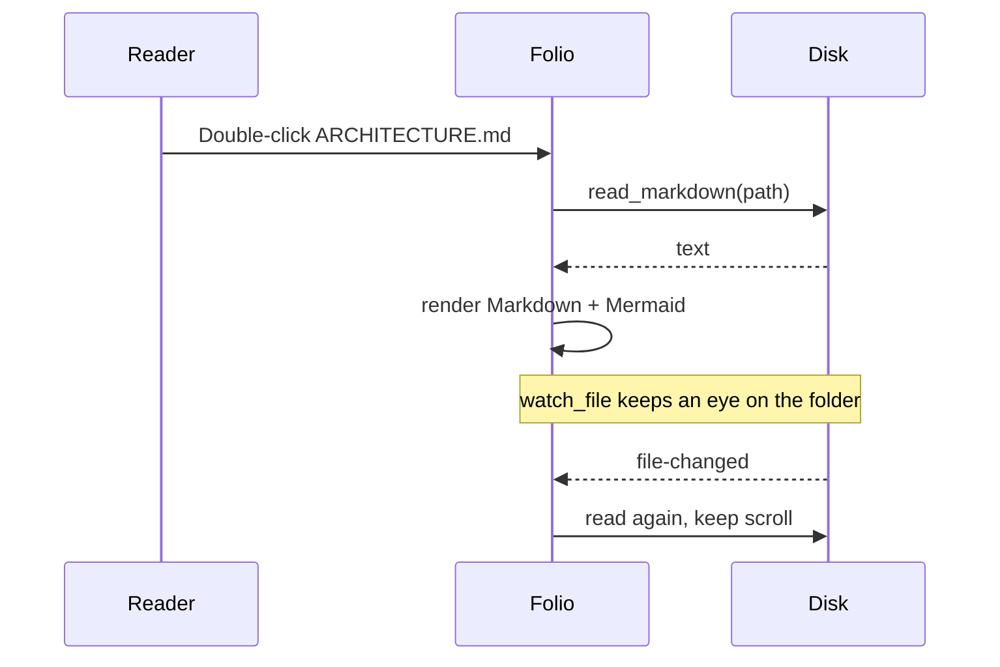

# Folio test document

This file exercises every block Folio renders. Open it after any change to the
renderer and scroll top to bottom. Jump to [the diagrams](#diagrams), read the
[Mermaid docs](https://mermaid.js.org/), or follow a [relative link](./second.md#second-heading).

## Diagrams

The flowchart below is the component diagram from an architecture doc, the case
that started this project: other viewers printed it as raw text.



A sequence diagram:



This one has a syntax error on purpose, so the error state shows:

```mermaid
graph TD
    A --> B -->
    this is not mermaid
```

## Code

```python
def reading_time(words: int, wpm: int = 230) -> float:
    """Minutes to read a document at a steady pace."""
    return round(words / wpm, 1)
```

```ts
export function fileName(path: string): string {
  const parts = path.split(/[\\/]/)
  return parts[parts.length - 1] || path
}
```

```
A fence with no language stays plain.
```

Inline code like `read_markdown` sits in the line.

## Tables

| Block        | Renderer        | Notes                    |
| ------------ | --------------- | ------------------------ |
| Markdown     | react-markdown  | GFM, sanitized raw HTML  |
| Code         | Shiki           | loads grammars on demand |
| Diagrams     | Mermaid         | themed to the paper      |
| Math         | KaTeX           | inline and display       |

### Task list

- [x] Render Mermaid
- [x] Highlight code
- [ ] Print stylesheet

## Math

Inline math such as $e^{i\pi} + 1 = 0$ flows with text. Display math:

$$
\text{Load ratio} = \frac{\text{Pending backlog}}{\text{Monthly capacity}}
$$

## Prose

> A quoted passage keeps its own voice, set in italic with a hairline beside it.

Text with a footnote.[^1] A missing local image falls back to its alt text:


---

### Deep heading

#### Fourth level

Last paragraph.

[^1]: Footnotes collect at the end of the document.
